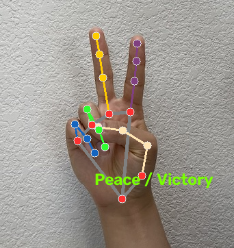

# Hand Gesture Recognition

Real-time hand-gesture recognition from a webcam using [MediaPipe](https://developers.google.com/mediapipe)
hand landmarks + OpenCV. Detects up to two hands, labels the gesture, counts
fingers, and can fire an action on each gesture (volume, play/pause, screenshot…).



## Gestures

| Gesture | Fingers (thumb→pinky) | Notes |
|---|---|---|
| Fist ✊ | `0 0 0 0 0` | |
| Open palm 🖐 | `1 1 1 1 1` | |
| Peace / Victory ✌️ | `0 1 1 0 0` | |
| Pointing ☝️ | `0 1 0 0 0` | |
| Thumbs up 👍 / down 👎 | `1 0 0 0 0` | direction from thumb angle |
| OK 👌 | thumb+index tips pinched, others open |
| Rock on 🤘 | `0 1 0 0 1` | |
| Spider-Man 🕸 | `1 1 0 0 1` | |
| Call me 🤙 | `1 0 0 0 1` | |
| Gun 🔫 | `1 1 0 0 0` | |
| Three / Four | `0 1 1 1 0` / `0 1 1 1 1` | |

Anything else falls back to a plain finger count.

## Setup

MediaPipe currently has **no working macOS wheel for Python 3.13/3.14**, so this
project uses **Python 3.12**.

```bash
cd "handgesture project"
python3.12 -m venv .venv
.venv/bin/python -m pip install -r requirements.txt
```

## Run

```bash
.venv/bin/python app.py                 # webcam, default camera
.venv/bin/python app.py --camera 1      # different camera
.venv/bin/python app.py --no-actions    # recognition only, no system actions
```

On macOS the first run needs **Camera** permission for your terminal
(System Settings → Privacy & Security → Camera).

Keys in the window: `q`/`Esc` quit · `a` toggle actions · `h` toggle HUD ·
`s` save a snapshot to `captures/`.

### No webcam? Run on a still image

```bash
.venv/bin/python demo_image.py path/to/hand.jpg
```

### Self-test (no camera, no model download)

```bash
.venv/bin/python selftest.py
```

## Files

| File | Purpose |
|---|---|
| `gestures.py` | Pure landmark → gesture logic (no MediaPipe/OpenCV import) |
| `hand_tracker.py` | MediaPipe Hands wrapper + skeleton drawing |
| `app.py` | Webcam loop, HUD, temporal smoothing |
| `actions.py` | Gesture → action mapper (edge-triggered, debounced) |
| `demo_image.py` | Run on a single image |
| `selftest.py` | Synthetic-landmark checks for `gestures.py` |

## Customising actions

Edit the `_ACTIONS` dict in `actions.py`. Each entry is
`"Gesture label": ("description", callback)`. Callbacks currently drive macOS via
`osascript`; swap in anything you like. Actions are edge-triggered (fire once when
you enter the gesture) with a hold time and cooldown so they don't spam.
